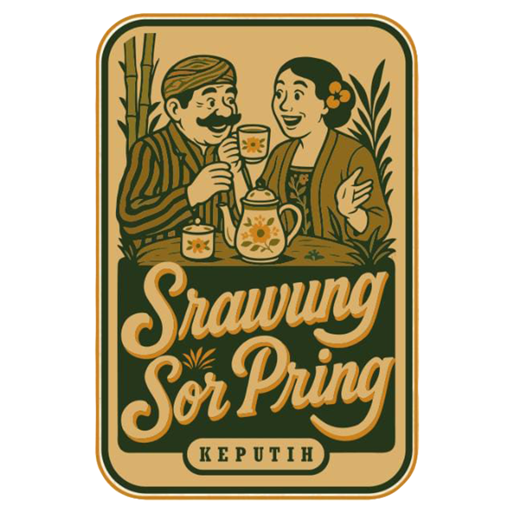
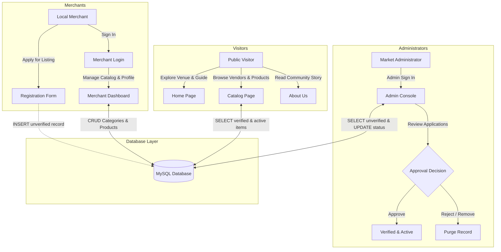
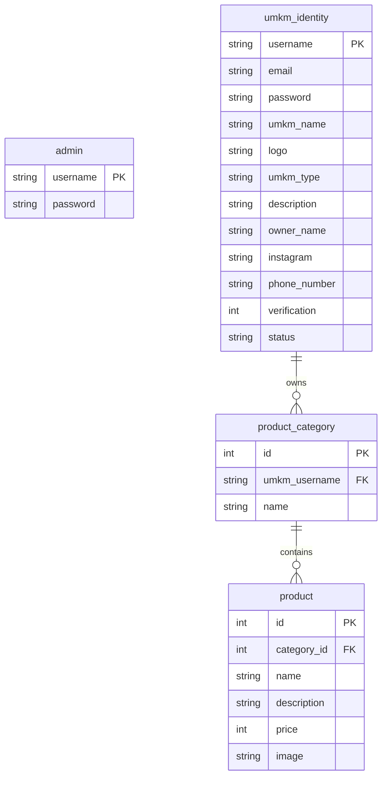

<div align="center">

  

  # 🌿 Srawung Sor Pring UMKM Catalog
  
  **Digital Catalog & Merchant Management Platform for Taman Harmoni Community Market**

  [](https://www.python.org/)
  [](https://streamlit.io/)
  [](https://www.mysql.com/)
  [](https://pandas.pydata.org/)
  [](https://opensource.org/licenses/Apache-2.0)
  [](#-about-the-project)

  <p align="center">
    <i>An end-to-end digital transformation platform designed to empower local micro, small, and medium enterprises (MSMEs/UMKM), enhance visitor exploration, and provide self-service store and catalog management.</i>
  </p>

  [Features](#-key-features) •
  [Architecture & ERD](#-system-architecture--database-design) •
  [Getting Started](#-installation--getting-started) •
  [Project Structure](#-project-structure) •
  [About Project](#-about-the-project)

</div>

---

## 📌 Executive Summary

**Srawung Sor Pring** is a community bazaar and culinary market located within the natural ambiance of Taman Harmoni in Keputih, Surabaya. The market offers a wide variety of traditional cuisine, artisan beverages, bamboo crafts, and local fashion, utilizing an eco-conscious physical coin exchange system.

This web application was engineered to address key real-world challenges faced by the community:
1. **Visitor Accessibility**: Enabling tourists and local visitors to easily access site plans, shopping procedures, and comprehensive merchant menus online before and during their visit.
2. **Merchant Self-Service**: Providing non-technical business owners with an intuitive portal to manage their operational information, product categories, and item listings in real-time.
3. **Administrative Governance**: Equipping market administrators with verification workflows to review, approve, or reject vendor registrations and regulate operational statuses.

---

## ✨ Key Features

### 👥 1. Visitor Portal (Public-Facing)
- **Interactive Landing Page**: Features a site layout map of Taman Harmoni, step-by-step shopping guides for the custom coin token system, and background details.
- **Dynamic Catalog**: Displays all active and verified merchants with branding logos, business categories, biographies, and direct links to Instagram profiles.
- **Interactive Product Modal**: Responsive dialog windows presenting menus grouped by category, complete with pricing and product photography.
- **Community Background**: An informational page highlighting the community development initiative by KKN Group 139 Arundiswara.

### 🏪 2. Merchant Portal (Self-Service Dashboard)
- **Vendor Onboarding**: Seamless registration flow capturing business information, owner credentials, operational type, branding assets, and contact channels.
- **Secure Authentication**: Session-state-driven login system validating against encrypted merchant credentials.
- **Store & Profile Management**: Real-time updates for business descriptions, owner details, WhatsApp contact, and social media handles.
- **Menu & Category Builder**: Full CRUD capabilities for custom product categories and menu items with pricing and images.
- **Account Security**: Self-service management for email, username, and password credentials.

### 🛡️ 3. Administrator Portal (Supervision & Operations)
- **Merchant Verification Workflow**: Dedicated administrative dashboard to review pending vendor applications with one-click approval or rejection.
- **Operational Status Control**: Quick toggle between *Active* and *Inactive* states to reflect real-world stall presence and scheduling.
- **Role-Based Protection**: Strict route guards ensuring administrative modules are accessible only to authorized accounts.

---

## 🛠️ Tech Stack & Implementation Details

| Layer | Technology | Role & Purpose |
| :--- | :--- | :--- |
| **Frontend & UI** | [Streamlit](https://streamlit.io/) (v1.46.1) | Multi-page Python web application framework with reactive components |
| **Data Processing** | [Pandas](https://pandas.pydata.org/) (v2.x) | Data manipulation, SQL query-to-DataFrame serialization, and CSV fallback |
| **Database** | [MySQL](https://www.mysql.com/) / Cloud DB | Relational database management system with foreign key integrity |
| **DB Connector** | `mysql-connector-python` | Database driver with cached resource pooling (`st.cache_resource`) |
| **UI Styling** | Custom CSS (`style.css`) | Modular styles for cards, headers, button states, and typography |
| **Programming Language** | Python 3.10+ | Leverages modern syntax, structural pattern matching (`match/case`), and type hints |

---

## 🏗 System Architecture & Database Design

### System Workflow



### Entity-Relationship Diagram (ERD)



<details>
<summary><b>Click to view MySQL DDL Schema</b></summary>

```sql
CREATE DATABASE IF NOT EXISTS sor_pring_db CHARACTER SET utf8mb4 COLLATE utf8mb4_unicode_ci;
USE sor_pring_db;

-- Administrator Credentials Table
CREATE TABLE IF NOT EXISTS `admin` (
    `username` VARCHAR(50) NOT NULL PRIMARY KEY,
    `password` VARCHAR(255) NOT NULL
) ENGINE=InnoDB DEFAULT CHARSET=utf8mb4;

-- Merchant Profile & Identity Table
CREATE TABLE IF NOT EXISTS `umkm_identity` (
    `username` VARCHAR(50) NOT NULL PRIMARY KEY,
    `email` VARCHAR(100) NOT NULL,
    `password` VARCHAR(255) NOT NULL,
    `umkm_name` VARCHAR(100) NOT NULL,
    `logo` TEXT DEFAULT NULL,
    `umkm_type` VARCHAR(50) NOT NULL,
    `description` TEXT DEFAULT NULL,
    `owner_name` VARCHAR(100) NOT NULL,
    `instagram` VARCHAR(50) DEFAULT NULL,
    `phone_number` VARCHAR(20) DEFAULT NULL,
    `verification` TINYINT(1) NOT NULL DEFAULT 0,
    `status` VARCHAR(20) NOT NULL DEFAULT 'Tidak Aktif'
) ENGINE=InnoDB DEFAULT CHARSET=utf8mb4;

-- Product Category Table
CREATE TABLE IF NOT EXISTS `product_category` (
    `id` INT AUTO_INCREMENT PRIMARY KEY,
    `umkm_username` VARCHAR(50) NOT NULL,
    `name` VARCHAR(100) NOT NULL,
    CONSTRAINT `fk_category_umkm` FOREIGN KEY (`umkm_username`) 
        REFERENCES `umkm_identity` (`username`) ON DELETE CASCADE ON UPDATE CASCADE
) ENGINE=InnoDB DEFAULT CHARSET=utf8mb4;

-- Product Items Table
CREATE TABLE IF NOT EXISTS `product` (
    `id` INT AUTO_INCREMENT PRIMARY KEY,
    `category_id` INT NOT NULL,
    `name` VARCHAR(100) NOT NULL,
    `description` TEXT DEFAULT NULL,
    `price` INT NOT NULL DEFAULT 0,
    `image` TEXT DEFAULT NULL,
    CONSTRAINT `fk_product_category` FOREIGN KEY (`category_id`) 
        REFERENCES `product_category` (`id`) ON DELETE CASCADE ON UPDATE CASCADE
) ENGINE=InnoDB DEFAULT CHARSET=utf8mb4;
```
</details>

---

## 📁 Project Structure

```text
srawung-sor-pring-catalog/
├── .streamlit/
│   ├── config.toml               # Streamlit application layout & server configuration
│   ├── secrets.toml.example      # Example environment credentials template
│   └── secrets.toml              # Active database credentials (ignored by git)
├── modules/                      # Reusable business logic & helper modules
│   ├── __init__.py               # Package initializer & functional exports
│   ├── admin_state.py            # Route guard & session validation for administrators
│   ├── umkm_state.py             # Route guard & session validation for merchants
│   ├── page_init.py              # Navigation setup, sidebar injection, and style bindings
│   └── database.py               # Database connector, cached query handlers, and DML operations
├── pages/                        # Multi-page application views
│   ├── about_us.py               # Community initiative & background story
│   ├── admin-login.py            # Administrator authentication form
│   ├── admin.py                  # Merchant verification & status control dashboard
│   ├── catalog.py                # Public merchant & product catalog
│   ├── login.py                  # Merchant authentication form
│   ├── profile-umkm.py           # Merchant profile & menu management console
│   ├── register.py               # New merchant registration form
│   └── registered.py             # Post-registration acknowledgment view
├── src/                          # Static assets & dataset files
│   ├── data/                     # Seed data (umkm.csv, umkm.xlsx)
│   └── img/                      # Logos, site plans, and documentation photos
├── LICENSE                       # Open-source license (Apache 2.0)
├── main.py                       # Application entry point (Landing Page)
├── README.md                     # Comprehensive technical documentation
├── requirements.txt              # Python package dependencies
└── style.css                     # Custom styling rules and layout enhancements
```

---

## 🚀 Installation & Getting Started

### 1. Prerequisites
- **Python**: Version `3.10` or higher
- **MySQL**: Local instance (MySQL Server / XAMPP) or a managed Cloud MySQL instance (e.g., Aiven, PlanetScale)
- **Git**

### 2. Clone Repository
```bash
git clone https://github.com/DaffinTW/srawung-sor-pring-catalog.git
cd srawung-sor-pring-catalog
```

### 3. Create & Activate Virtual Environment
- **Linux / macOS**:
  ```bash
  python3 -m venv venv
  source venv/bin/activate
  ```
- **Windows (Command Prompt / PowerShell)**:
  ```bash
  python -m venv venv
  venv\Scripts\activate
  ```

### 4. Install Dependencies
```bash
pip install -r requirements.txt
```

### 5. Configure Database Credentials
Create a local copy of the secrets template:
```bash
cp .streamlit/secrets.toml.example .streamlit/secrets.toml
```

Edit `.streamlit/secrets.toml` with your database connection parameters:
```toml
[db_credentials]
host = "localhost"
port = 3306
username = "root"
password = "your_mysql_password"
database = "sor_pring_db"
charset = "utf8mb4"
```

> **Note**: Execute the SQL DDL statements found in the [Database Design](#-system-architecture--database-design) section above to initialize the database tables before starting the application.

### 6. Launch the Application
```bash
streamlit run main.py
```
The application will open automatically in your default browser at `http://localhost:8501`.

---

## 👥 About the Project

This project was conceived and built as part of the **Community Service Program (Kuliah Kerja Nyata / KKN) Group 139 - Arundiswara** in Keputih, Sukolilo, Surabaya. The program focuses on grassroots economic empowerment by introducing digital infrastructure to traditional community markets and promoting local MSMEs to a wider public audience.

### Maintainers & Contributors
- **Lead Developer**: [Daffin_TW](https://github.com/Daffin-TW)
- **Initiative Team**: Student Members of KKN 139 Arundiswara

---

## 📄 License

This repository is licensed under the **Apache License 2.0**. Refer to the [LICENSE](file:///mnt/data/Kuliah/KKN/Tugas/Website/srawung-sor-pring-catalog/LICENSE) file for terms and conditions.
